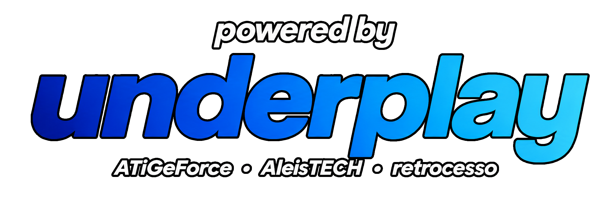

# Mushroom Recompiled

**The ROM is not included with the project or the ZIP.** Select your compatible copy from the menu. The full game has not yet been validated.

## Stable release — v1.6.0

Includes the native Linux / Steam Deck frontend described below and the existing Windows frontend. Linux/SteamOS hardware compatibility remains experimental; see [validation](docs/LINUX_VALIDATION.md).

## Widescreen and scene fixes — v1.5

The downloadable version expands the scenery of horizontal stages to a 16:9 canvas without stretching tiles or sprites. The original HUD remains centered, with black bars on the sides. Select **Video > Aspect Ratio > 16:9**; new configurations already use this mode.

The compositor uses the actual stage map. The widescreen mode extends object activation, horizontal culling, and rendering to the 16:9 area; vertical rooms and unsupported scenes remain in native framing. Read the [limits and tests](docs/WIDESCREEN.md). Historical packages remain available with updated download names.
The current build keeps reward/bonus scenes centered with clean black margins and repairs object seams at the original viewport edges. It extends enemy activation and persistence to the 16:9 area and draws their sprites outside the old clipping region. Retains edge and menu fixes. Remembers the ROM and launches directly; Esc opens the menu during gameplay.

## Download and test

Download the [Windows x64 and Linux x86-64 packages](https://github.com/Adoregabriel2005/mushroomrecompiled/releases/tag/v1.6.0), extract the complete package, and run **MushroomRecompiled.exe** on Windows. For Linux, run `bash run-steamdeck.sh --rom "/path/game.nes"`; see [STEAMDECK.md](STEAMDECK.md).

1. Choose **Select ROM**.
2. Point to the game ROM as a `.nes` file.
3. After validation, the game starts. On subsequent launches, the remembered ROM is loaded directly.

**Esc** pauses and opens the menu to save, load, continue, configure, or quit. If no ROM is registered, or if the saved file is missing/incompatible, the launcher appears. Direct startup does not automatically load a save state.

Requires Windows x64 and a video/audio device recognized by the system. No minimum requirements certification has been performed. Read the [testing guide](docs/TESTAR.md) and the [settings documentation](docs/INTERFACE.md).

## Interface

The launcher uses the project identity and the original Underplay image supplied by the project owner. In-window settings: keyboard, controller, video, audio, ROM, Project, and Credits. Apply saves changes; Discard preserves the previous ones.

- Controls: automatic or per-device selection, remapping, dead zone, button test, D-pad and analog. USB/Bluetooth/receivers via SDL2 and SDL_GameControllerDB, based on Windows recognition and pairing.
- Video: aspect ratio, integer scale/fit/crop, filter, scanlines, brightness, resolution, and borderless fullscreen. 16:9 expands the scenery and object activation range in supported horizontal stages while keeping the original HUD.
- Audio: volume, mute, device, 44.1/48/96 kHz, and 20/40/60 ms buffer reserve.
- Save states: five slots; save/load from the menu.

| Action | Default keyboard | Default controller |
|---|---|---|
| Move | Arrow keys | D-pad / analog |
| B: run / tail | Z | X / Square |
| A: jump / fly | X | A / Cross |
| Select: items | Shift | Back / Share |
| Start: NES pause | Enter | Start / Options |
| PC menu | Esc | Home / Guide, remappable |
| Fullscreen | F11 | Via menu |
| Save state slot | 1 to 5 | Via menu |

Specific physical controllers still need retesting. Automated testing uses a virtual SDL joystick; this does not prove compatibility with every model.

## Technical status

Cycle-accurate NESRecomp backend: 6502 code translated to C and compiled natively, with PPU/APU/DMA/MMC3 synchronized by the runtime.

In the 3,000-frame test script, approximately **99.995% of cycles** ran recompiled code. An instruction crossing a bank boundary uses an interpreted fallback. All 3,000 state hashes matched the interpreted execution under the same hardware model. This validates the translation for that script, not all stages nor independent equivalence with a physical console.

The following also passed: continuation after save/load, audio at all three sample rates, and interface tests (seven pages, apply/discard, and virtual hotplug). Details in [STATUS](docs/STATUS.md).

## Building

Requires Windows, CMake, LLVM-MinGW/Clang, and mingw32-make in PATH. The first setup downloads the official SDL2 2.30.0 package and verifies its SHA-256.

```powershell
.\build-local.ps1 -RomPath "C:\path\GAME NAME.nes"
```

The script compiles the NESRecomp generator, produces the C blocks using your ROM and the seeds in docs/smb3-cycle-seeds.txt, and compiles the application. Generated files are not versioned. Output: build/MushroomRecompiled-v1.6.0.exe.

```powershell
.\build-local.ps1 -RomPath "Game name.NES" -Verify
cd build
.\smb3-ui-verify.exe
```

Auxiliary inspection: `node tools/rom.mjs <ROM.nes> [extraction directory]`; parser tests: `node --test tests/rom.test.mjs`.

## Experimental Linux / Steam Deck build

The minimal native SDL2 frontend supports stereo audio, Steam Input-compatible
controllers, fullscreen, 4:3 / expanded 16:9, PC pause and one quicksave slot.
Simulation timing is independent of the 30/40/60 FPS presentation limit, with
bounded catch-up after stalls. The Win32 frontend and Windows build remain.

```sh
sudo apt-get install build-essential cmake ninja-build pkg-config libsdl2-dev
bash tools/build-linux.sh --check  # ROM-free compilation and host tests
bash tools/build-linux.sh --rom '/path/game.nes' --verify
bash run-steamdeck.sh --rom '/path/game.nes' --fps 40
```

See [STEAMDECK.md](STEAMDECK.md) for controls, dependencies, optional rotated
performance logs, canonical ROM SHA-256 and limitations. This is native CPU
recompilation with emulated NES hardware, not a full native game engine.
No ROM, generated game C, saves, binaries or Nintendo game assets are added by
this patch or its ROM-free CI. Users provide their own compatible ROM locally.
SteamOS compatibility may require rebuilding on the target system; physical
Steam Deck verification is separate from automated host tests.

## Credits and licenses


Beta testers: **ALEISTECH** and **RETROCESSO**. Thanks for the testing and bug reports.

Independent, unofficial project. [Branding](docs/BRANDING.md).

The integration code is licensed under MIT. NESRecomp is licensed under **PolyForm Noncommercial 1.0.0**; the MIT license of the interface does not alter the runtime's terms. See [LICENSE_SCOPE](LICENSE_SCOPE.md) and LICENSES. The ROM and generated assets are not published; the release executable contains code and materials derived from the game.

[](https://underplay.com.br)
