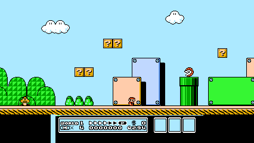
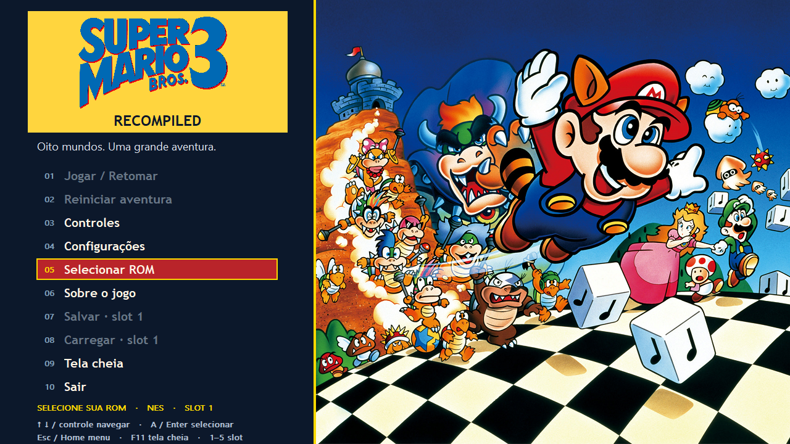
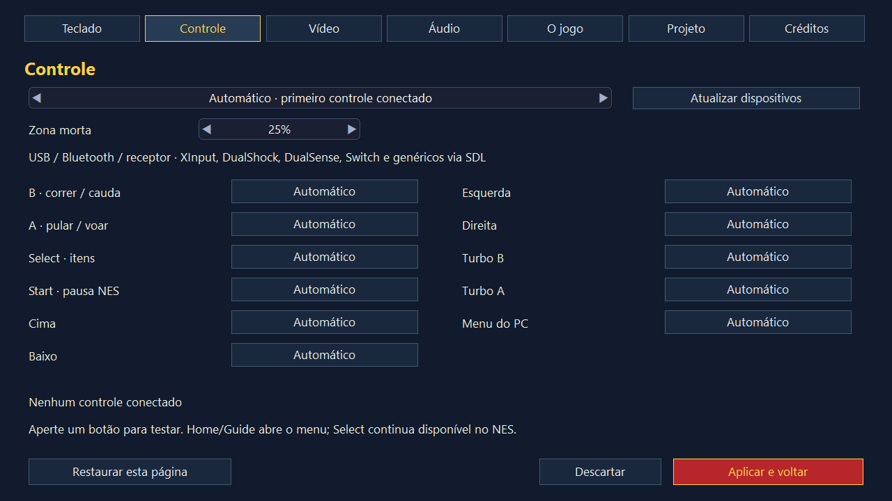

# Super Mario Bros. 3 — Recompiled

Port experimental de **Super Mario Bros. 3 (NES)** para Windows x64, com recompilação estática via NESRecomp, launcher, controles e save states.

**A ROM não acompanha o projeto nem o ZIP.** Selecione sua cópia compatível no menu. O jogo inteiro ainda não foi validado.

## Prévia widescreen v1.3

A [prévia experimental v1.3](https://github.com/Adoregabriel2005/super-mario-bros-3-recomp/releases/tag/v1.3.0-exp) amplia o cenário das fases horizontais para um canvas 16:9, sem esticar tiles ou sprites. O HUD original permanece centralizado, com barras pretas nas laterais. Selecione **Vídeo > Proporção > 16:9**; configurações novas já usam esse modo.



O compositor usa o mapa real da fase. A ativação de inimigos continua seguindo as regras originais; salas verticais e cenas não suportadas ficam no enquadramento nativo. Leia os [limites e testes](docs/WIDESCREEN.md). A v1.2 permanece disponível para comparação.
Atualização: [v1.3.4 experimental](https://github.com/Adoregabriel2005/super-mario-bros-3-recomp/releases/tag/v1.3.4-exp) corrige os fragmentos duplicados de logo, textos e arte ao redimensionar o launcher. Mantém o reparo das bordas no widescreen e a correção visual das configurações. Lembra a ROM e inicia diretamente; Esc abre o menu durante a partida.

## Baixar e testar

Baixe o [release Windows portátil](https://github.com/Adoregabriel2005/super-mario-bros-3-recomp/releases/tag/v1.3.4-exp), extraia o ZIP inteiro e abra **SuperMarioBros3Recomp.exe**. Mantenha SDL2.dll e assets ao lado do executável.

1. Escolha **Selecionar ROM**.
2. Indique **Super Mario Bros. 3 (USA) (Rev 1)**, arquivo `.nes`.
3. Após a validação, o jogo inicia. Nas próximas aberturas, a ROM lembrada é carregada diretamente.

**Esc** pausa e abre o menu para salvar, carregar, continuar, configurar ou sair. Sem ROM cadastrada, ou se o arquivo salvo estiver ausente/incompatível, o launcher aparece. A inicialização direta não carrega um save state automaticamente.

Requer Windows x64 e um dispositivo de vídeo/áudio reconhecido pelo sistema. Não foi feita certificação de requisitos mínimos. Leia o [guia de teste](docs/TESTAR.md) e as [configurações](docs/INTERFACE.md).



## Interface

O menu usa logo e ilustrações originais de época, com **RECOMPILED** junto ao logo. Configurações dentro da janela: teclado, controle, vídeo, áudio, O jogo, Projeto e Créditos. Aplicar salva as alterações; Descartar preserva as anteriores.

- Controles: seleção automática ou por dispositivo, remapeamento, zona morta, teste de botão, D-pad e analógico. USB/Bluetooth/receptores via SDL2 e SDL_GameControllerDB, conforme reconhecimento e pareamento no Windows.
- Vídeo: proporção, escala inteira/ajuste/recorte, filtro, scanlines, brilho, resolução e tela cheia sem bordas. 16:9 altera a apresentação, sem ampliar o campo de visão.
- Áudio: volume, mute, dispositivo, 44,1/48/96 kHz e reserva de 20/40/60 ms.
- Save states: cinco slots; salvar/carregar no menu.



| Ação | Teclado padrão | Controle padrão |
|---|---|---|
| Mover | Setas | D-pad / analógico |
| B: correr / cauda | Z | X / Quadrado |
| A: pular / voar | X | A / Cruz |
| Select: itens | Shift | Back / Share |
| Start: pausa NES | Enter | Start / Options |
| Menu do PC | Esc | Home / Guide, remapeável |
| Tela cheia | F11 | Pelo menu |
| Slot de save state | 1 a 5 | Pelo menu |

Controles físicos específicos ainda precisam de reteste. O teste automatizado usa um joystick virtual SDL; isso não comprova compatibilidade de cada modelo.

## Estado técnico

Backend cycle-accurate do NESRecomp: código 6502 traduzido para C e compilado nativamente, com PPU/APU/DMA/MMC3 sincronizados pelo runtime.

No roteiro de 3.000 quadros, cerca de **99,995% dos ciclos** executaram código recompilado. Uma instrução cruzando banco usa fallback interpretado. Todos os 3.000 hashes de estado coincidiram com a execução interpretada sob o mesmo modelo de hardware. Isso valida a tradução nesse roteiro, não todas as fases nem equivalência independente com um console físico.

Também passaram os testes de continuação após save/load, áudio nas três frequências e interface (sete páginas, aplicar/descartar e hotplug virtual). Detalhes em [STATUS](docs/STATUS.md).

## Compilar

Requer Windows, CMake, LLVM-MinGW/Clang e mingw32-make no PATH. A primeira preparação baixa o pacote oficial SDL2 2.30.0 e verifica SHA-256.

```powershell
.\build-local.ps1 -RomPath "C:\caminho\Super Mario Bros. 3 (USA) (Rev 1).nes"
```

O script compila o gerador NESRecomp, gera os blocos C usando sua ROM e os seeds em docs/smb3-cycle-seeds.txt e compila o aplicativo. Os arquivos gerados não são versionados. Saída: build/SuperMarioBros3Recomp-v1.3.4.exe.

```powershell
.\build-local.ps1 -RomPath "C:\caminho\Super Mario Bros. 3 (USA) (Rev 1).nes" -Verify
cd build
.\smb3-ui-verify.exe
```

Inspeção auxiliar: `node tools/rom.mjs <ROM.nes> [diretório de extração]`; testes do parser: `node --test tests/rom.test.mjs`.

## Créditos e licenças

Jogo, personagens e artes: Nintendo. Projeto de fã, independente e não oficial. [Fontes das artes](docs/ARTES.md).

Base: [NESRecomp](https://github.com/mstan/nesrecomp), Matthew Stanley e colaboradores; SDL2; SDL_GameControllerDB. Referência de experiência: [Mônica no Castelo do Dragão Recomp](https://github.com/Adoregabriel2005/monica-no-castelo-do-dragao-recomp), de Adoregabriel2005.

O código próprio de integração tem licença MIT. NESRecomp tem licença **PolyForm Noncommercial 1.0.0**; a licença MIT da interface não altera as condições do runtime. Consulte [LICENSE_SCOPE](LICENSE_SCOPE.md) e LICENSES. A ROM e fontes gerados não são publicados; o executável do release contém código e materiais derivados do jogo.
